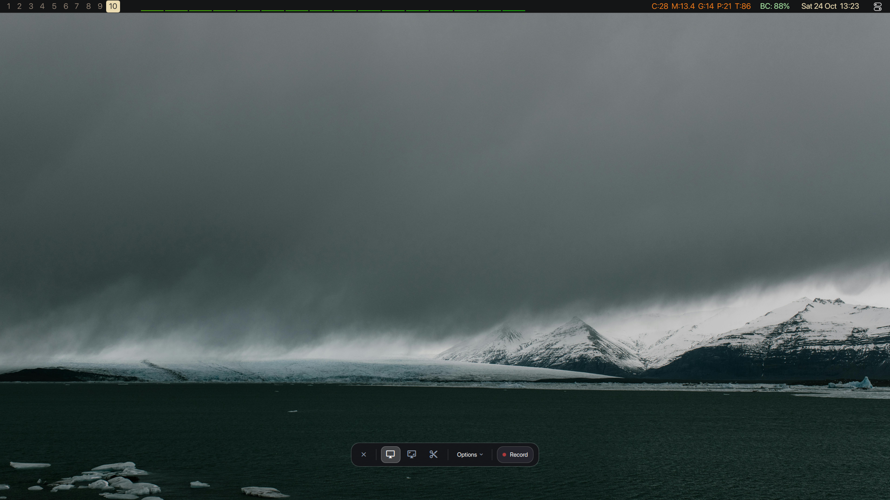
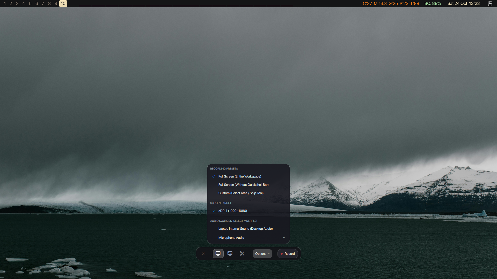
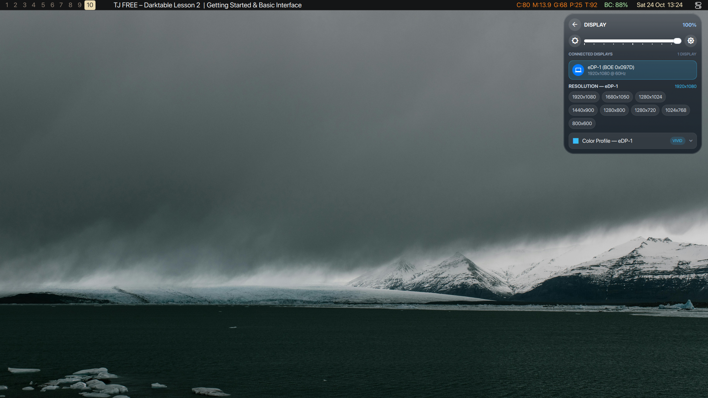
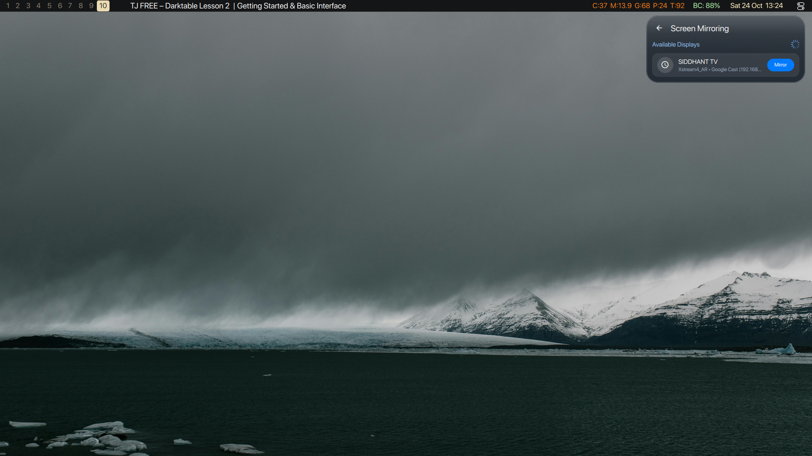
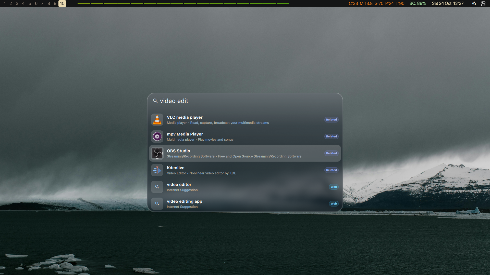

# SilkyShell

A lightweight, modern desktop shell built on **[Quickshell](https://outfoxxed.me/quickshell/)** and tailored for **Hyprland** (Wayland).

SilkyShell is crafted for those seeking **simplicity and practicality** paired with **smooth 60fps liquid motions**, while keeping everything resource-efficient, robust, and highly optimized. No bloated widgets you never touch—just the essentials crafted with fluid animations, native PipeWire/MPRIS integration, hardware-accelerated screen capture, and clean Apple-inspired aesthetics.

---

## Overview


---

## Menus & Core Features

### 1. Top Bar (`Bar.qml`)
A slim, 28px persistent status bar anchored to the top of your monitor. Features dynamic exclusive layer zone negotiation, allowing seamless toggling between reserved bar spacing and true edge-to-edge full screen.

* **Workspaces**: Dynamic sliding pill indicator with spring physics reflecting active and occupied Hyprland workspaces.
* **Media Island**: Central dynamic island displaying live track title, artist, audio status, or volume OSD with single/double-click controls.
* **Status Devices**: Real-time hardware stream indicators with dedicated badges for:
  - 🎤 **Microphone** (Yellow): Click to mute/unmute; right-click for input sources.
  - 📷 **Camera** (Green): Active PipeWire / V4L2 webcam detection.
  - 🖥️ **Screen Share** (Purple): Active portal / WebRTC stream detection.
  - 🔴 **Screen Recording** (Red): Dedicated recording indicator with instant access to the floating recording toolbar.
* **Dynamic Wallpaper Colors**: Automatically derives hue-matched bar background and accent colors from the active wallpaper (`wallpaper-theme.py`) with smooth color transitions.
* **System Tray & Metrics**: Compact monitors for CPU %, RAM, GPU, battery status, and connected Bluetooth peripherals.
* **Clock & Toggles**: Quick launchers for Control Center and Notification Center.

---

### 2. Apple macOS Screen Recording Studio (`ScreenRecordingBar.qml`)
An authentic macOS-style floating screen recording toolbar positioned gracefully above the bottom edge of the screen.



#### Features:
* **Hardware-Accelerated 60 FPS Engine**: Ultra-fast VA-API and H.264 video encoding via `wf-recorder` supervisor (`screenrecord-service.py`).
* **Instant Optimistic UI**: Zero-lag start and stop animations with live elapsed recording timer.
* **Interactive Snip Tool**: Real-time interactive screen selection via `slurp` with live dimension readout and dimming overlay.
* **Multi-Monitor Quick Switching**: Dynamic display target switching buttons for multi-monitor setups.
* **Options Popover**:
  - **Recording Presets**: Full Screen (Entire Workspace), Full Screen (Without Quickshell Bar), Custom (Select Area / Snip Tool).
  - **Screen Target**: Dynamic selection of connected displays.
  - **Audio Routing**: Internal Desktop Sound, Microphone input, or None.



---

### 3. Control Center (`ControlCenter.qml`)
A unified glass quick-settings dashboard designed for rapid daily system adjustments.


#### Submenus & Widgets:
* **Liquid Glass Media Playback Widget (`MediaPlaybackWidget.qml`)**
  A 2×2 squircle card integrated directly into the Control Center grid. Features persistent album artwork, track title, artist, volume integration, and smooth contoured playback controls (Previous, Play/Pause, Next).

* **Sound & Output Submenu (`screenshots/control_center_sound.png`)**
  - **PipeWire Audio Multi-Mixer (`audio-multimixer.py`)**: Play audio simultaneously across multiple physical output sinks (e.g., Bluetooth headphones + laptop speakers) via a persistent null-sink hub architecture.
  - **Sync Delay Calibration**: Adjustable latency compensation slider (0–500ms) to ensure wireless Bluetooth audio stays perfectly in sync with wired speakers.
  - **Granular Device Control**: Individual volume sliders and mute toggles per output sink.

  

* **Display Management & Arrangement Submenu (`screenshots/control_center_display.png`)**
  - **Per-Monitor Brightness**: Smooth logarithmic brightness sliders supporting internal panels and external DDC/CI monitors.
  - **Display Topology Arrangement**: Visual drag-and-drop / position arrangement for multi-monitor layouts.
  - **Hardware Color Profiles**: Dynamic per-monitor color profiles including *Standard*, *sRGB*, *DCI-P3*, *Vivid*, *Warm*, *Reading*, and *Night Shift*.
  - **Resolution & Refresh Rate Switching**: Instant switching across supported monitor video modes.

  

* **Wireless Screen Casting Submenu (`screenshots/control_center_cast.png`)**
  - Zero-resource on-demand mDNS discovery service (`screencast-service.py`).
  - Stream your desktop wirelessly to **Google Cast (Chromecast)**, **AirPlay**, **Miracast**, and **DLNA** displays.

  

* **Wi-Fi Submenu (`screenshots/control_center_wifi.png`)**
  Scans nearby wireless networks in real time, displays SSID signal strengths, handles connect/disconnect states, and provides an in-place password prompt modal.

  

* **Bluetooth Submenu (`screenshots/control_center_bluetooth.png`)**
  Scans and manages Bluetooth peripherals with category-specific vector icons (earbuds, tws, headphones, speakers, gamepads, watches). Shows paired statuses, live battery levels, and audio profile selection (A2DP / HFP).

  

* **Screen Time Submenu (`screenshots/control_center_screentime.png`)**
  Tracks and visualizes your daily productivity with total active time and app usage breakdowns.

  

---

### 4. Spotlight (`Spotlight.qml` & `SpotlightBar.qml`)
A centered, fluid command palette and semantic launcher invoked on demand (`SUPER + Space`).


#### Modes & Features:
* **Semantic Concept Search (`SpotlightSemantic.js`)**: Intelligently maps human concepts to installed applications and workflows (e.g., searching "video edit" yields Kdenlive, DaVinci Resolve, and OBS Studio).
  
  

* **Integrated Web Quick Search (`web-search.py`)**: Instant answers, Wikipedia summaries, Google autocomplete suggestions, and Chrome bookmarks integration with category badge pills (*Web*, *App*, *Related*, *File*, *Clip*, *Bookmark*).

  

* **Application Grid (Key `1`)**: Interactive grid of all installed desktop applications.

  

* **Clipboard History (Key `3`)**: Persistent clipboard history with search, one-click copy, item deletion, and clear-all actions.

  

---

### 5. Media Menu (`MediaMenu.qml`)
An expanded liquid glass music cockpit connected directly to the Media Island.


* **Music Player Card**: Live track title and artist, cinematic artwork background with automatic palette extraction, multi-player switcher, and a liquid wave progress slider.
* **Volume Mixer**: Master volume slider and granular per-stream sliders for active applications.
* **Cava Visualizer**: Real-time audio visualizer supporting 3 animated themes (*Vertical Bars*, *Symmetric Mirror*, and *Wave Bezier*) with 15-second smooth rotation intervals.

---

### 6. Notification Center (`NotificationWidget.qml`)
macOS-inspired floating notification cards and notification history panel.


* **Grouped Cards**: Notifications organized by application with squircle badges and timestamps.
* **Fluid 60fps Dismissal**: Buttery smooth swipe gestures and spring transitions.
* **Clear All**: Dismiss all saved notifications at once.
* **Do Not Disturb (DND)**: Seamless mute toggle integrated directly with the Control Center.

---

### 7. Interactive Screenshot Hub (`ScreenshotWidget.qml`)
A native Quickshell screenshot preview and action hub.


* **Liquid Floating Card**: Smoothly animates into the bottom-right corner upon capture (area, active window, or full screen).
* **Auto-Dismiss Progress Timer**: Visual countdown bar showing when the preview will dismiss itself (pauses on hover).
* **Drag-and-Drop (DND)**: Drag screenshot thumbnails directly into Discord, Slack, Telegram, or web browsers.
* **Instant Annotation**: Jump directly into Satty for markup.

---

## Architectural & Infrastructure Enhancements

* **`Paths.qml` Universal Resolver**: A centralized singleton resolving script and asset paths dynamically relative to the active installation (`Paths.script(...)`, `Paths.mediaIcon(...)`), eliminating hardcoded user home directories.
* **`qs_daemon_base.py` Daemon Architecture**: Enterprise-grade base class for all background Python D-Bus services:
  - Linux `PR_SET_PDEATHSIG` ensures child daemons terminate instantly if Quickshell exits.
  - Stdin EOF detection prevents zombie or orphan background processes.
  - Singleton file locking prevents duplicate backend instances.
  - Debounced signal emissions with sleep/wake and lid monitoring.
* **Hyprland Direct IPC Dispatch**: Migrated window focus and workspace navigation from shell evaluation to direct Hyprland IPC calls.

---

## Quickshell IPC Command Reference

All shell features can be controlled externally via `quickshell ipc call <target> <function>`:

| Target | Function | Description |
| :--- | :--- | :--- |
| `screenrecord` | `open` / `close` / `toggle` | Toggle floating screen recording toolbar |
| `screenrecord` | `toggleOptions` | Toggle recording presets & audio options popover |
| `screenrecord` | `start` / `stop` | Start or stop active screen recording |
| `screenrecord` | `snip` | Launch interactive area selection tool |
| `controlcenter` | `open` / `close` / `toggle` | Toggle main Control Center panel |
| `controlcenter` | `openSound` | Open Sound & Multi-Mixer drawer |
| `controlcenter` | `openDisplay` | Open Display Management & Color Profiles drawer |
| `controlcenter` | `openCast` | Open Wireless Screen Mirroring drawer |
| `controlcenter` | `openBluetooth` / `openWifi` | Open Bluetooth or Wi-Fi drawers |
| `controlcenter` | `toggleMultiMixer` | Toggle simultaneous multi-sink audio playback |
| `bar` | `toggle` / `show` / `hide` | Toggle or show/hide top bar with dynamic exclusive zone |
| `spotlight` | `open` / `close` / `toggle` | Toggle Spotlight command bar |
| `spotlight` | `search "<query>"` | Open Spotlight with pre-filled search query |
| `screenshot` | `full` / `window` / `area` | Trigger screenshot capture modes |

---

## Requirements

* **[Quickshell](https://outfoxxed.me/quickshell/)** (Qt 6 / QML Wayland shell engine)
* **Hyprland** (Wayland compositor)
* **PipeWire** & `wireplumber` (Audio routing and latency-compensated multi-mixing)
* **wf-recorder** (Hardware-accelerated 60 FPS screen recording)
* **cava** (Real-time audio visualizer)
* **grim** & **slurp** (Screenshot & region selection utilities)
* **Python 3** with `python-dbus`, `pygobject`, `Pillow`
* Fonts: **SF Pro Rounded** / **JetBrainsMono Nerd Font**

---

## Installation & Running

Clone the repository into your preferred directory:

```bash
git clone https://github.com/<username>/SilkyShell.git
cd SilkyShell
```

### Run Directly:
```bash
quickshell -p shell.qml
```

### Symlink as Default Quickshell Config:
```bash
mkdir -p ~/.config/quickshell
ln -sf "$(pwd)"/* ~/.config/quickshell/
quickshell
```

### Sync Local Changes:
```bash
./sync_config.sh
```
