# SilkyShell

A lightweight, modern desktop shell built on **[Quickshell](https://outfoxxed.me/quickshell/)** and tailored for **Hyprland** (Wayland).

SilkyShell is made for someone looking for **simplicity and practicality** paired with **smooth 60fps liquid motions**, while keeping everything resource-efficient and highly optimized. No bloated widgets you never touch—just the essentials crafted with fluid animations, native PipeWire/Mpris integration, and clean aesthetics.

---

## Overview

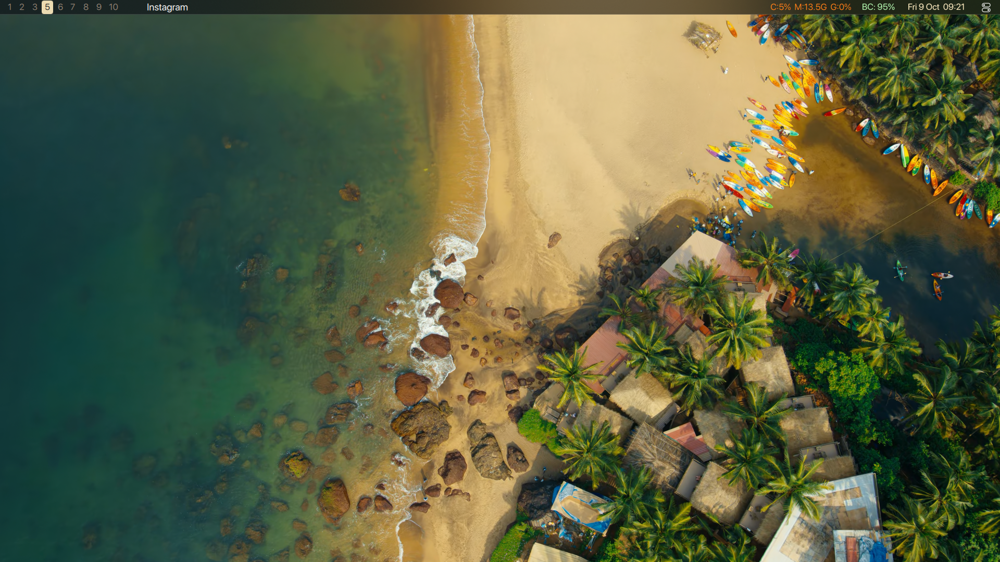

---

## Menus & Features

### 1. Top Bar (`Bar.qml`)
A slim, 28px persistent status bar anchored to the top of the monitor. It reserves its own layer space to prevent window overlap while keeping system status and controls one click away.

- **Workspaces**: Dynamic sliding pill indicator with spring physics reflecting your active and occupied Hyprland workspaces.
- **Media Island**: Central dynamic island displaying current track title, artist, audio status, or volume OSD with single/double-click controls.
- **System Tray & Metrics**: Compact monitors for CPU %, RAM, GPU, battery status, and connected Bluetooth peripherals.
- **Clock & Toggles**: Quick launchers for Control Center and Notification Center.

---

### 2. Control Center (`ControlCenter.qml`)
A unified glass quick-settings dashboard designed for rapid daily system adjustments.

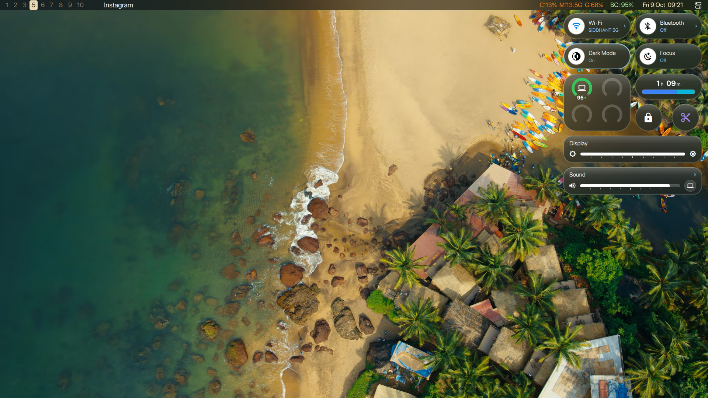

**In a nutshell:** One-stop hub for toggling essential system states, monitoring battery and active screen time, and adjusting master brightness and audio volume.

#### Submenus:
* **Wi-Fi Submenu** (`screenshots/control_center_wifi.png`)
  Scans nearby wireless networks in real time, displays SSID signal strengths, handles connect/disconnect states, and provides an in-place password prompt modal.
  <br/><br/>
  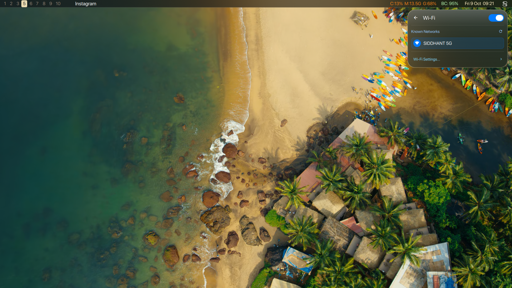

* **Bluetooth Submenu** (`screenshots/control_center_bluetooth.png`)
  Scans and manages Bluetooth peripherals. Lists paired devices, current battery percentages, and allows quick one-click reconnects.
  <br/><br/>
  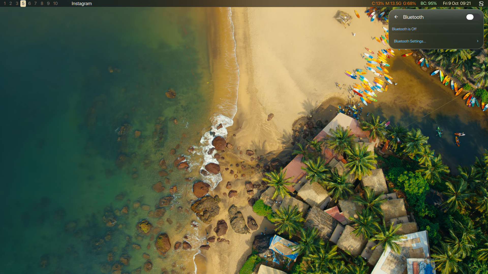

* **Sound & Output Submenu** (`screenshots/control_center_sound.png`)
  Direct PipeWire audio sink switcher. Select default audio outputs (speakers, headphones, HDMI) and adjust master volume levels.
  <br/><br/>
  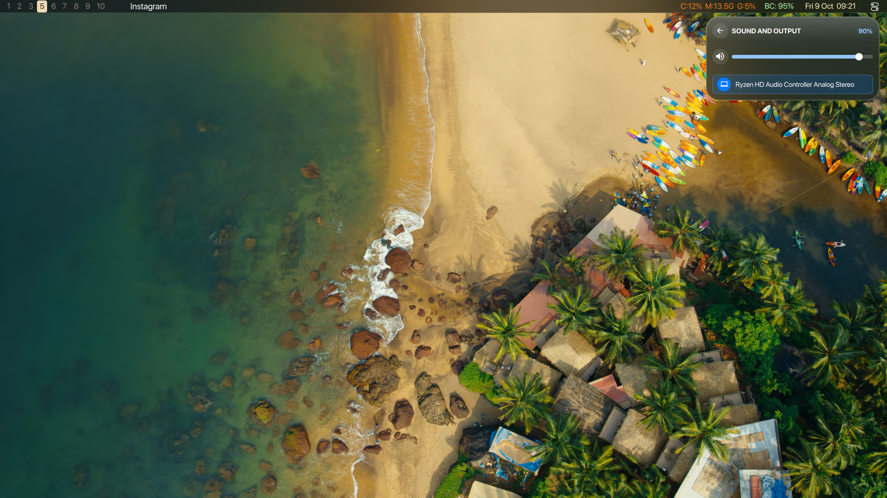

* **Screen Time Submenu** (`screenshots/control_center_screentime.png`)
  Tracks and visualizes your daily productivity. Displays total active screen time alongside a breakdown of your most frequently used apps.
  <br/><br/>
  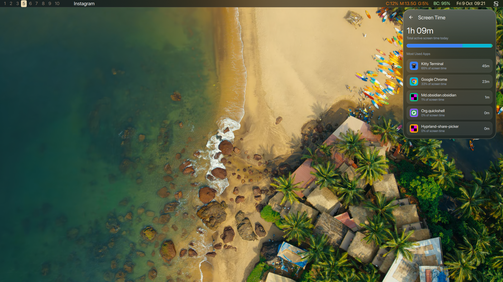

---

### 3. Media Menu (`MediaMenu.qml`)
An expanded liquid glass music hub connected directly to the Media Island.

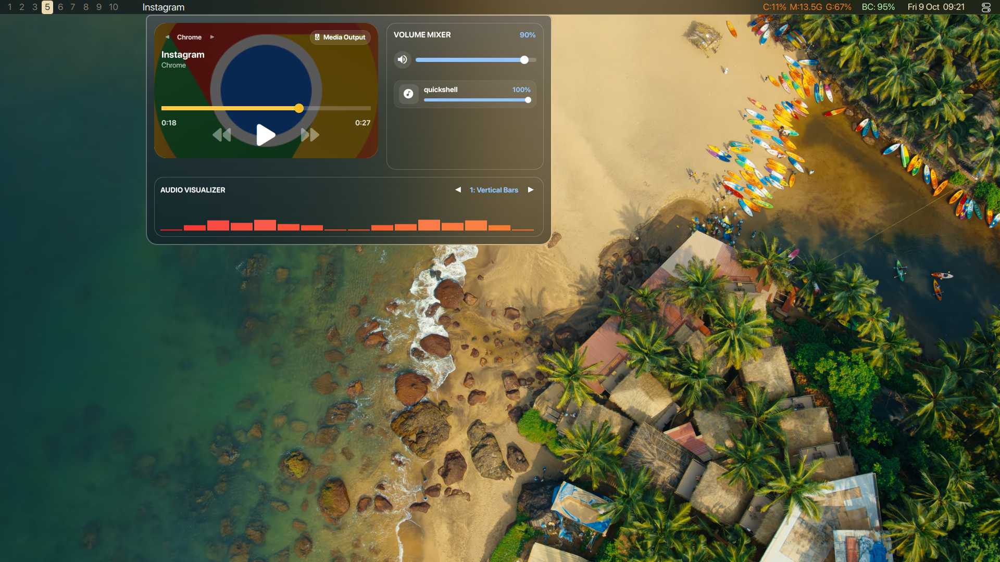

**In a nutshell:** Complete multimedia cockpit combining player controls, per-application volume mixing, and real-time audio visualization.

#### What's inside:
* **Music Player Card**: Live track title and artist, cinematic artwork background with automatic palette extraction, multi-player switcher (◀ Player ▶), and a liquid wave progress slider.
* **Volume Mixer**: Master volume slider and granular per-stream sliders for active applications.
* **Audio Visualizer**: Real-time Cava audio visualizer canvas supporting 3 animated themes (*Vertical Bars*, *Symmetric Mirror*, and *Wave Bezier*).

---

### 4. Notification Center (`NotificationWidget.qml`)
macOS-inspired floating notification cards and notification history panel.

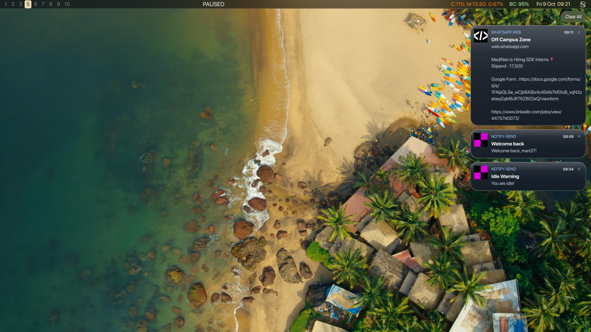

**In a nutshell:** Displays incoming notification popups and keeps a grouped notification history log without cluttering your desktop.

#### Key details:
* **Grouped Cards**: Notifications are organized by application with squircle badges and timestamps.
* **60fps Dismissal**: Buttery smooth left-to-right swipe-away animations.
* **Clear All**: Floating action pill to dismiss all saved notifications at once.
* **Do Not Disturb (DND)**: Seamless mute toggle integrated directly with the Control Center.

---

### 5. Spotlight (`Spotlight.qml` & `SpotlightBar.qml`)
A centered, fluid command palette and application launcher invoked on demand.

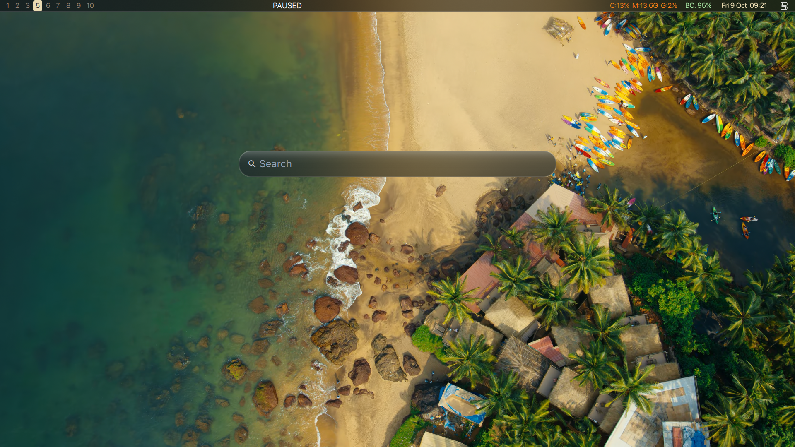

**In a nutshell:** Quick application launcher, clipboard manager, and calculator search bar that appears instantly with spring animations.

#### Modes & Submenus:
* **Fuzzy Search & Calculator**: Type to instantly search apps, evaluate arithmetic calculations, or run web queries.
  <br/><br/>
  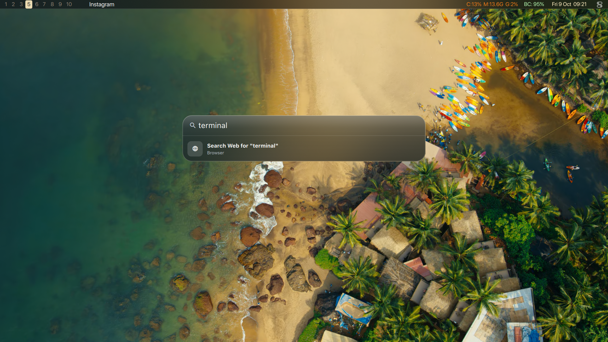

* **Application Grid (Key `1`)**: Displays an interactive grid of all installed system applications categorized with high-resolution icons.
  <br/><br/>
  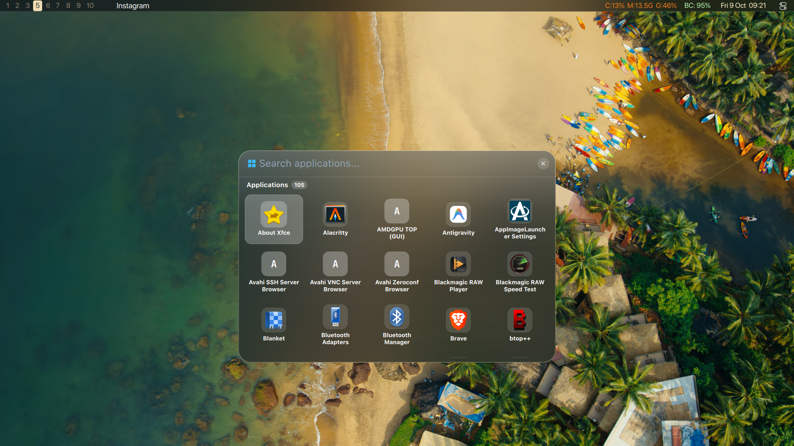

* **Clipboard History (Key `3`)**: Persistent clipboard history with search, one-click copy, item deletion, and clear-all actions.
  <br/><br/>
  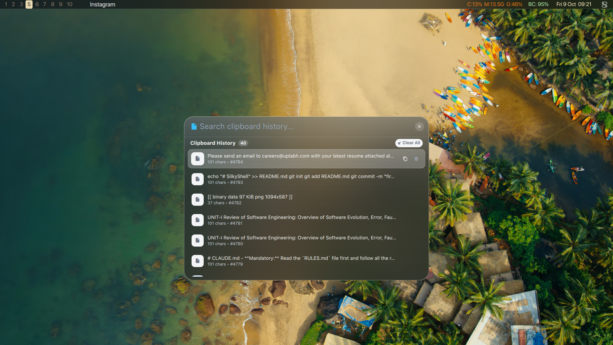

---

### 6. Interactive Screenshot Hub (`ScreenshotWidget.qml`)
A native Quickshell screenshot preview and action hub.

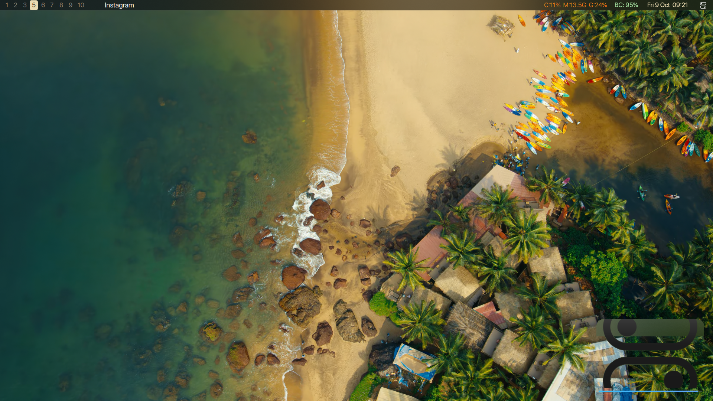

**In a nutshell:** Provides immediate visual confirmation of screen captures with interactive preview cards.

#### Features:
* **Liquid Floating Card**: Smoothly animates into the bottom-right corner upon capture (area, active window, or full screen).
* **Auto-Dismiss Progress Timer**: Visual countdown bar showing when the preview will dismiss itself (pauses immediately on hover).
* **Drag-and-Drop (DND)**: Click and drag the screenshot thumbnail directly out of the preview card into Discord, Slack, Telegram, or web browsers.
* **Instant Edit**: One-click button to jump directly into the annotation tool (Satty).

---

## Requirements

- **[Quickshell](https://outfoxxed.me/quickshell/)** (Qt 6 / QML Wayland shell engine)
- **Hyprland** (Wayland compositor)
- **PipeWire** & `wpctl` (Audio control)
- **cava** (Audio visualizer)
- **grim** & **slurp** (Screenshot utilities)
- **Python 3** (Helper scripts for screen time and palette extraction)
- Fonts: SF Pro Rounded / JetBrainsMono Nerd Font

---

## Running SilkyShell

To run directly with Quickshell:

```bash
quickshell -c /path/to/SilkyShell
```

Or copy/symlink to your configuration directory:

```bash
ln -sf /path/to/SilkyShell ~/.config/quickshell
quickshell
```

To update SilkyShell from your local setup at any time:

```bash
./sync_config.sh
```
