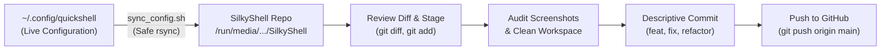

# Quickshell & SilkyShell Git Commit & Contribution Guidelines

This guide outlines the mandatory rules and workflow for committing and syncing changes made to the Quickshell configuration (`~/.config/quickshell`) into the public **SilkyShell** repository (`/run/media/banana/Alpha/project/SilkyShell`).

---

## Architecture & Workflow Overview

* **Active Working Directory:** `~/.config/quickshell` (where live development, testing, and debugging occur).
* **Git Repository Directory:** `/run/media/banana/Alpha/project/SilkyShell` (where version control, documentation, and releases live).
* **Synchronization Bridge:** `sync_config.sh` (safely mirrors active configuration from `~/.config/quickshell` into the SilkyShell repository without modifying `~/.config/quickshell`).



---

## Rule 1: The Config Synchronization & Git Commit Pipeline

Whenever changes are made, tested, and verified in `~/.config/quickshell`, follow these sequential steps to commit them into SilkyShell:

### 1. Navigate to the SilkyShell Project Directory
Always run the sync and git operations directly from the repository root:
```bash
cd /run/media/banana/Alpha/project/SilkyShell
```

### 2. Run the Configuration Sync Script
Execute `sync_config.sh` to sync all modified QML components, Python helper daemons, Bash scripts, and media assets into the repository:
```bash
./sync_config.sh
```
> [!NOTE]
> `sync_config.sh` is completely **read-only** with respect to `~/.config/quickshell`. It will never delete or overwrite files in your active config directory.

### 3. Review Modified and Untracked Files
Inspect what files were changed or added:
```bash
git status
```
Inspect line-by-line diffs to verify there are no accidental edits, leftover debug logs, or hardcoded personal paths:
```bash
git diff
```

### 4. Stage Relevant Files
Stage only the modified files relevant to the changes made (avoid staging unintended or temporary artifacts):
```bash
# Add specific files:
git add modules/Bar.qml scripts/screenrecord-service.py

# Or stage all tracked changes:
git add -u
```

### 5. Prepare a Rich, Structured Commit Message
Every commit must have a clear title adhering to Conventional Commits, accompanied by a comprehensive description that details:
* **All Bugs Fixed**: Root cause, symptoms, and how they were resolved.
* **All Features Added**: New components, interactive controls, backend services, or UI options.
* **All Architecture & Code Changes**: Refactoring, file reorganizations, performance enhancements, and state persistence updates.

#### Commit Message Format
```text
<type>(<scope>): <concise high-level summary>

- <Feature or Component Name> (<File(s) Changed>):
  • Detailed bullet point describing the feature or architectural change
  • Performance characteristics, protocols, or models introduced

- Bug Fixes & Stability (<File(s) Changed>):
  • Specific bug resolved, edge cases handled, or race conditions fixed
  • Compositor or Wayland compatibility improvements

- UI/UX & Visual Polish (<File(s) Changed>):
  • Animation curves, styling updates, layout adjustments
  • Updated screenshots or README documentation
```

#### Standard Commit Types
* `feat`: A new feature or major enhancement
* `fix`: A bug fix or error mitigation
* `refactor`: Code restructuring without behavioral change
* `perf`: Performance improvement (e.g., reducing CPU/RAM, lower IPC latency)
* `style`: Cosmetic UI changes, typography, or spacing
* `docs`: README updates, guides, or media asset revisions
* `chore`: Maintenance tasks, gitignore adjustments, script updates

---

## Rule 2: Visual Assets (Screenshots & Recordings) & Privacy Protocol

Visual documentation is a core part of SilkyShell. Whenever new features are introduced or existing UI components change, the repository media must remain up-to-date and pristine.

### 1. Audit Media Assets with Every Feature Change
* **Check existing media:** Inspect the `screenshots/` directory and references in `README.md`.
* **Evaluate freshness:** If a widget, menu, bar, or modal was redesigned, the corresponding screenshot in `screenshots/` must be updated.
* **Add new assets:** If a new feature or popover is added (e.g., a new Control Center submenu, recording HUD, or OSD), take a high-resolution screenshot and link it in `README.md`.

### 2. Strict Clean Workspace & Zero-Leakage Privacy Protocol

> [!CAUTION]
> **NEVER take screenshots or screen recordings on a workspace containing personal windows, open chats, sensitive browser tabs, or private notifications.**

Follow this strict capture protocol before capturing any screenshot or video demo:

1. **ALWAYS Open a Brand New Workspace:**
   * Switch to an empty Hyprland workspace (e.g., `Super + 9` or `Super + 0`) dedicated strictly to the screenshot session.
   * Do **NOT** keep open personal browser tabs, terminal windows with personal file paths/IPs, Telegram/Discord chats, or code editors showing private keys or user data in the background.

2. **Clean Wallpaper & Aesthetic Backdrop:**
   * Ensure a clean, visually appealing desktop wallpaper is visible behind the UI components.
   * If an app window is needed to show blur/acrylic glass effects, open an innocuous window (like a clean terminal displaying `fastfetch` or an empty Neovim buffer).

3. **Silence & Clear All Notifications:**
   * Check the Notification Center (`modules/NotificationWidget.qml`) and clear all active notifications.
   * Ensure no notification popups or private messages appear during capture.
   * If testing notifications specifically, generate mock/dummy notifications using `notify-send "Test Title" "Sample message description"`.

4. **Sanitize Media & Player Island:**
   * Ensure `MediaIsland.qml` or `MediaPlaybackWidget.qml` does not display sensitive, personal, or controversial media tracks.
   * Use an open/royalty-free track or standard test media if showcasing playback.

5. **Sanitize Device & Network Data:**
   * Verify that Wi-Fi SSID names shown in Control Center do not leak private home addresses or personal identity.
   * Ensure Bluetooth device names do not contain full personal names or phone numbers.

---

## Pre-Commit Verification Checklist

Before running `git commit` and `git push`, run through this quick checklist:

- [ ] Ran `quickshell --check` or tested modified QML files to verify no syntax errors exist.
- [ ] Verified Python scripts compile cleanly (`python3 -m py_compile scripts/*.py`).
- [ ] Ran `./sync_config.sh` from `/run/media/banana/Alpha/project/SilkyShell`.
- [ ] Inspected `git status` to ensure no temporary `.cache`, credentials, or unwanted files are staged.
- [ ] Reviewed `git diff` to confirm only intended changes are present.
- [ ] Checked screenshots / videos: updated any outdated images in `screenshots/` and `README.md`.
- [ ] Confirmed all screenshots were taken on a clean workspace with zero private notifications or user data leaked.
- [ ] Prepared a thorough commit message detailing bugs fixed, features added, and files modified.

---

## Quick Reference / Copy-Paste Cheat Sheet

```bash
# 1. Switch to repo directory
cd /run/media/banana/Alpha/project/SilkyShell

# 2. Sync active Quickshell changes
./sync_config.sh

# 3. Check changes and inspect diff
git status
git diff

# 4. Stage modified files
git add <modified-files>

# 5. Commit with descriptive message
git commit -m "feat(scope): concise summary

- Component / Feature details
- Bug fixes and stability
- UI polish & screenshot updates"

# 6. Push to repository
git push origin main
```
